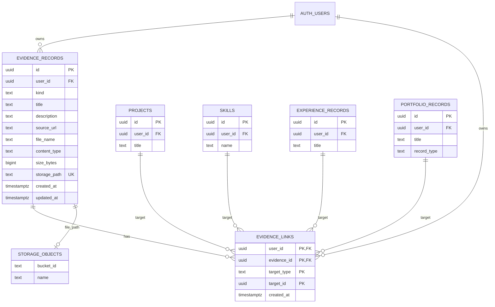

# Evidence schema

This diagram describes the private Evidence tables added by
`20261025100000_create_evidence.sql`. Existing target tables are created by
earlier migrations. `evidence_links.target_type` and `target_id` form a
polymorphic reference; the database trigger checks that the referenced target
exists and belongs to the same user. They are not direct foreign keys because
the target can be one of four different tables.

Storage objects live in the private `evidence` bucket at
`<user-id>/<generated-name>`. The app opens them using short-lived signed URLs.
An evidence file row cannot be deleted while its object remains in Storage;
the Storage API must remove the object first. URL evidence has no Storage
object. Deleting a linked project, skill, experience, certification, or
achievement removes that target's link rows while preserving the evidence.
