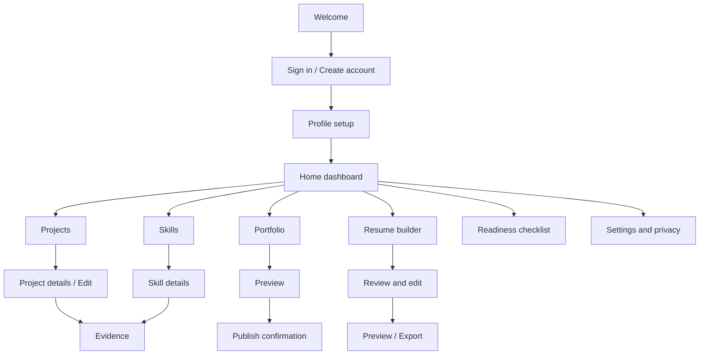
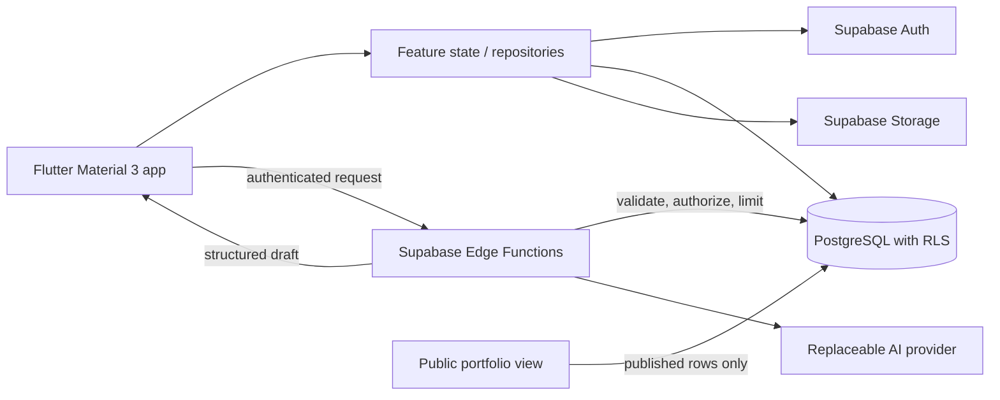
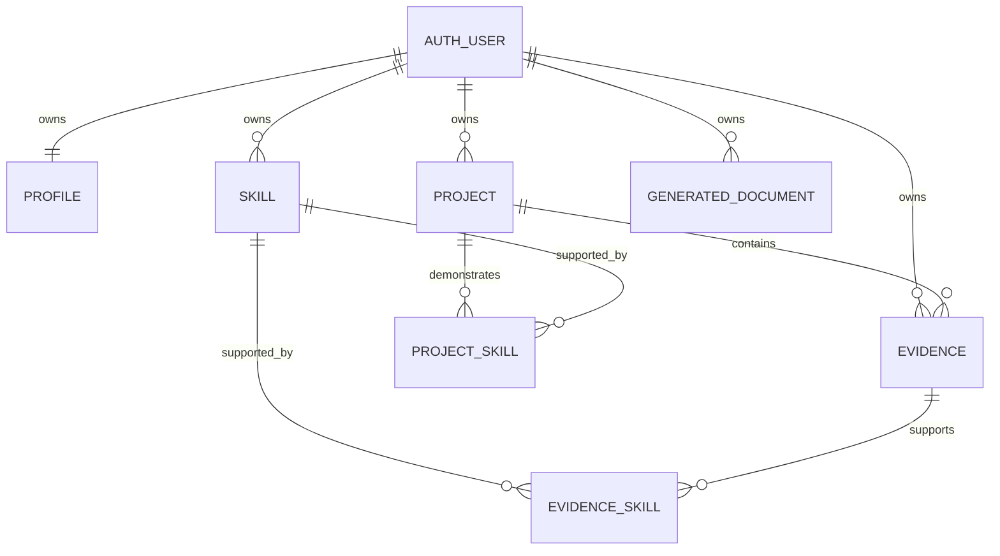

# Prooffolio project blueprint

**Status:** Approved by the user. The initial Flutter scaffold now exists in `app_name/`; its foundation theme, four-destination shell, Supabase auth entry, session gate, profile setup, password recovery, and project CRUD flow are implemented. Supabase project creation and configuration remain a user setup step, and the project migration must be applied before live project data appears.

## Product intent

Prooffolio helps students turn real work into credible career materials. A student records projects, connects skills to specific evidence, then chooses what to share in a public portfolio or an editable, ATS-friendly resume. AI can improve wording, but it must use only user-supplied facts and must never publish or export content without review.

The defining experience is the trace from a skill claim to a project and its supporting proof. Evidence supports a claim; it is not a certification or an automatic measure of mastery.

## Goals and boundaries

### MVP goals

- Establish a working Android Flutter app with a coherent Material 3 theme and accessible navigation.
- Support account, profile, project, skill, and evidence workflows with ownership enforced by Supabase.
- Let the owner preview and explicitly publish selected portfolio content.
- Add one secure, editable AI resume workflow after the underlying records and permissions work.
- Keep core record keeping useful when AI is unavailable.

### Later or optional

- AI portfolio copy generation, DOCX export, public website polish, richer search, and mentor feedback.
- A separate public website framework. Decide between Flutter Web and React only after the mobile MVP is working.
- Dark mode, until the light theme and core workflows are stable.

### Anti-goals

- Generating the whole product in one pass.
- Inventing achievements, skills, qualifications, or metrics.
- Treating repository links or evidence quantity as verified competence.
- Putting provider secrets, Supabase service-role keys, or authorization rules in the client.
- Requiring paid services for the core MVP.

## Visual direction

Design the app as a **quiet evidence workspace**: clear, editorially restrained, and organized around the relationship between work, skills, and proof. The distinctive element is a compact evidence trail that visibly links a skill to a project and then to a source. Keep the rest of the interface calm and familiar to Android users; avoid generic gradients, decorative charts, repeated identical cards, and AI-generated filler copy.

Use the supplied brand tokens as the source of truth:

| Token | Value | Use |
| --- | --- | --- |
| Deep Navy | `#14213D` | Brand, primary headings, important navigation |
| Indigo | `#4F46E5` | Primary actions, selection, links, progress |
| Teal | `#0F766E` | Restrained completion and positive states |
| Cloud White | `#F8FAFC` | Main background |
| Slate Black | `#0F172A` | Primary text |
| Slate Gray | `#64748B` | Supporting text |
| Light Slate | `#E2E8F0` | Dividers and quiet outlines |
| White | `#FFFFFF` | Content surfaces |

Use Android's system sans-serif for the first build so the app loads quickly and respects platform text scaling. Establish a type scale through Material 3 roles rather than styling each screen independently. Use an 8 dp spacing rhythm, restrained surface treatment, consistent corner radii, visible focus/pressed states, and touch targets of at least 48 dp. Do not use color alone to communicate readiness or publication state.

## Navigation and screen flow



For the authenticated app, use a small bottom navigation set: **Home**, **Projects**, **Skills**, and **Portfolio**. Put account, privacy, and settings behind the profile affordance. Keep evidence creation contextual to a project or skill so users can see what a piece of evidence supports. Resume generation and readiness are reachable from Home and Portfolio rather than adding more bottom-nav destinations. Authentication and first-run setup sit outside the main navigation shell.

## Flutter structure

Start feature-first and keep data access out of widget build methods:

```text
lib/
  main.dart
  app/
    app.dart
    router.dart
  core/
    theme/
      app_colors.dart
      app_theme.dart
      app_spacing.dart
    widgets/
    utils/
  data/
    models/
    repositories/
    services/
  features/
    auth/
    dashboard/
    profile/
    projects/
    skills/
    evidence/
    portfolio/
    resume/
    readiness/
    settings/
```

Use a repository boundary for persistence and a service boundary for Supabase/AI calls. Adopt Riverpod and GoRouter when their use begins to simplify shared state and navigation; keep the foundation milestone small. Do not add abstractions or packages without a current use. Resolve compatible package versions from current package documentation at implementation time.

## Architecture



Supabase enforces ownership and publication access through Row Level Security; hidden UI controls are not security. AI requests go through an authenticated Edge Function, which validates inputs, checks ownership, minimizes personal data, applies limits, validates structured output, and returns an editable draft. Never execute generated code or render untrusted HTML. Public reads return only explicitly published fields and records.

## Initial database proposal

Use UUID primary keys, timestamps, foreign keys, indexes on ownership/lookup columns, and RLS on exposed tables. A SQL migration is the source of truth.



Initial tables: `profiles` (one-to-one with auth user; unique username and visibility settings), `projects`, `skills`, `project_skills`, `evidence`, `evidence_skills`, and `generated_documents`. Put `user_id` on owned records. Use composite constraints or carefully scoped policies so a project-skill relationship cannot cross owners. Evidence can optionally relate to a project and can link to one or more skills through `evidence_skills`. Generated documents store reviewed structured content, type, target role, selected record references, and timestamps; avoid retaining unnecessary raw prompts or sensitive personal information.

Before public portfolio reads are implemented, define a narrow published view/RPC or equivalent policy that exposes only approved fields. Keep private drafts and storage objects private by default. The exact policies and SQL belong in reviewed, version-controlled migrations before backend features are connected.

## Eight-week implementation sequence

| Week | Milestone | Demonstrable outcome |
| --- | --- | --- |
| 1 | Foundation and design | Android Flutter shell, theme tokens, routing, Git, project documentation |
| 2 | Authentication and profile | Sign up, login, recovery, session persistence, profile setup |
| 3 | Projects | Owned project create/read/update/delete and validation |
| 4 | Skills and evidence | Skill library, project-skill links, evidence records |
| 5 | Portfolio | Preview, explicit publication controls, protected public view |
| 6 | Resume workflow | Secure AI draft, editable review, PDF export if feasible |
| 7 | Refinement | Workflow checks, accessibility and privacy review, defect fixes |
| 8 | Release preparation | Signed Android build, store assets, closed testing/release checklist |

This is a target sequence, not a guarantee. If time becomes tight, prioritize a reliable Android MVP with projects, skills, evidence, one resume workflow, and basic portfolio sharing. Verify current Play Console account, testing, policy, and fee requirements before release; they can change.

## Prioritized MVP checklist

1. Flutter Android project builds and launches; theme and navigation work.
2. Authentication, session persistence, profile setup, logout, and recovery.
3. Profile privacy and account deletion flow are documented and implemented safely.
4. Project CRUD with validation and delete confirmation.
5. Skills CRUD and accurate self-reported status labels.
6. Evidence CRUD and explicit skill/project relationships.
7. Backend ownership, RLS, private storage, and cross-user access protections.
8. Portfolio preview, selected published content, publish/unpublish, and share link.
9. Readiness checklist based on ordinary application logic.
10. One secure AI resume draft flow with user review before export; graceful offline/quota handling.
11. Release build, privacy review, store materials, and current Play release requirements.

## First implementation milestone: foundation

The user has already run `flutter create --org com.prooffolio app_name`. The generated project is in `app_name/`, and its current Android namespace/application ID is `com.prooffolio.app_name`. Do not rerun `flutter create`. The project has no Git repository yet. First inspect the generated app and initialize Git from inside `app_name/` if appropriate:

```powershell
flutter doctor
Set-Location .\app_name
git init
git add .
git commit -m "Create Prooffolio Flutter foundation"
flutter run
```

The supplied terminal output confirms Flutter and package resolution are working. `git status` reports that `app_name/` is not yet a Git repository. Keep the current application ID during the UI foundation milestone; decide whether `com.prooffolio.app_name` is the permanent release ID before publishing, because changing it later creates a different Play app.

The first code changes after project creation should be limited to the Material 3 theme tokens and a navigable empty shell. No Supabase keys, schema, AI provider, or advanced features belong in this milestone.

## Decisions and open implementation details

- **Given by the brief:** Android-first Flutter, Supabase, evidence-centered product, official palette, free-first strategy, explicit AI review, and eight-week target.
- **Working design calls:** 4-item bottom navigation; Android system sans-serif; feature-first structure; keep the existing `app_name/` scaffold and `com.prooffolio.app_name` ID during the first UI milestone; assume a fresh Supabase development project will be created during the authentication milestone.
- **Confirm before release:** permanent Android application ID, privacy policy/data disclosures, current Play Console testing and account requirements, service pricing/quotas, and actual public hosting domain.

